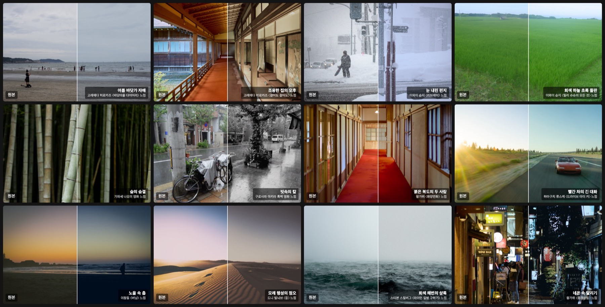

# Chiyo Film

English · **[한국어](README.md)**

**Free · Works inside Lightroom Classic & Photoshop · 154 film looks · Spectral film colour**

A film-emulation editor for Mac. Film looks built from real datasheet curves, plus photo adjustments, face retouching, frames and cinema looks — in one app.


<sub>Left: original · Right: Chiyo Film (film + exposure, white balance, grain, halation). Example photos are CC0 (public domain) from Wikimedia Commons.</sub>


## Download

**[Get the latest release](../../releases/latest)** → `ChiyoFilm-1.6.0.pkg`

- macOS 13 or later, Apple Silicon (M1 or later)
- Lightroom Classic and/or Photoshop 2025 or later (optional — the editor also works on its own)
- Manual: **[ChiyoFilm-Manual-EN.pdf](ChiyoFilm-Manual-EN.pdf)**
- Licence: **[LICENSE.en](LICENSE.en)** (English translation; the Korean [LICENSE](LICENSE) governs) — free test version for personal, non-commercial use; no redistribution; your output photos are yours to use freely.

The app follows your Mac's language. To switch: **Advanced › 언어 · Language** (Auto · 한국어 · English).

## Install

1. Quit Photoshop and Lightroom Classic (save your work first).
2. Open `ChiyoFilm-1.6.0.pkg`. If macOS says "unidentified developer", **right-click › Open** in Finder, or **System Settings › Privacy & Security › Open Anyway**.
3. The editor app, the Photoshop plugin and the Lightroom plugin are installed together.
4. **Once in Lightroom:** Settings › External Editing › Additional External Editor › Choose › `/Applications/Chiyo Film.app`
   - File format **TIFF or PSD**, **16-bit**, colour space as you usually work (ProPhoto RGB or Adobe RGB)
   - Preset › Save Current Settings as New Preset › "Chiyo Film"

## Use

| Where | How |
|---|---|
| Lightroom Classic | Right-click a photo › Edit In › **Chiyo Film** (⌥⌘E) → edit → **Apply** (Return) → appears next to the original |
| Lightroom, many photos | File › Plug-in Extras › **Chiyo Film: Apply to Selected Photos…** (TIFF / JPEG / PSD, added to the catalogue) |
| Photoshop | Plugins › Chiyo Film › **Open Chiyo Film Editor** → Apply adds a new layer |
| Standalone | Drop JPEG · TIFF · PSD files on `Chiyo Film.app` |
| Batch in the editor | File › **Apply to Multiple Photos…** (⇧⌘B) |
| 2–4 photos on one canvas | File › **Create Multi-Photo Layout…** (⇧⌘L) |

> **Tip:** do the basic RAW development (exposure, white balance) in Lightroom first, then add the film look in Chiyo Film.

## Highlights (1.6)

- **Spectral film colour (new):** models each film layer's spectral sensitivity and, for print stocks (cinema print 2383, paper), the dyes printing onto each other. Reds and skin come out cleaner and less muddy; cinema print skies turn teal on their own. New edits use it by default; edits saved earlier open unchanged (Adjust › Film › Color science).
- **English interface (new)**
- **Picks for this photo:** suggests 3–5 looks for each photo from its colours, subject and mood, with a reason.
- **30 cinema looks:** moods inspired by Japanese, Korean and world cinema (e.g. "Seaside Sisters in Summer — Kore-eda Hirokazu · Our Little Sister feel"), tuned by measuring stills and reading cinematography notes. Interpretations only — not affiliated with any filmmaker or studio, and no film stills ship with the app.
- **Film frames:** 2.39 scope and 1.85 flat letterbox, subtitle scene.
- **Develop & print:** push/pull development, printer points R·G·B, preflash, print toe/shoulder shape, bleach bypass (creative model).
- **Texture & optics:** grain and halation scaled to film format (half frame → 4×5), datasheet-based grain, diffusion filters (Black mist, White mist, Glimmer, Cine bloom — maskable), lens chromatic aberration and coma.
- **154 film looks:** 59 rendered from characteristic curves digitised from manufacturers' datasheets. Own short codes (e.g. N101 · Natural portrait) with a small "~ feel" line naming the stock it references.
- **Photo adjustments like Lightroom:** Basic, Tone Curve (incl. Luminance), Color Mixer, Color Grading, Precision Color (lift/gamma/gain/offset, hue curves), Detail, Lens Corrections.
- **Face retouch & skin tone:** blemish removal (moles kept unless you choose), dark circles, even skin with texture kept, contouring; skin-tone uniformity with a colour wheel.
- **Masks:** radial, linear, brush, luminance, colour range, auto subject / person / sky.
- **Frames & layouts:** 26 frames (palette, captions, film strip, contact sheet, deckle, textures), 2–4 photo layouts with carousel export.
- Reference-photo look matching, `.cube` LUT export, GPU real-time preview, histogram / waveform / RGB parade.
- Everything runs locally on your Mac — no account, no internet.



<sub>Cinema look examples on CC0 photos (not film stills). Left original · right look.</sub>


## Changes

See [Releases](../../releases).

## Reporting problems

Create a report with **Advanced › Create Problem Report File…** and attach it to an [Issue](../../issues) with your macOS / Photoshop / Lightroom versions and the photo format. Please don't upload personal photos.

## Uninstall

```sh
sudo "/Library/Application Support/Chiyo Film/1.6.0/uninstall.sh"
```

Your presets and favourites (`~/Library/Application Support/Chiyo Film`) are kept.

---

Free test version, provided without any warranty (see the [licence](LICENSE.en)). Keep your originals backed up. Film looks are expressive models based on public characteristic curves, datasheets and scans; they are not guaranteed to match real film. Film and manufacturer names are trademarks of their respective owners and are used only to describe which stock a look references; Chiyo Film is not affiliated with them. Example photos are CC0.
