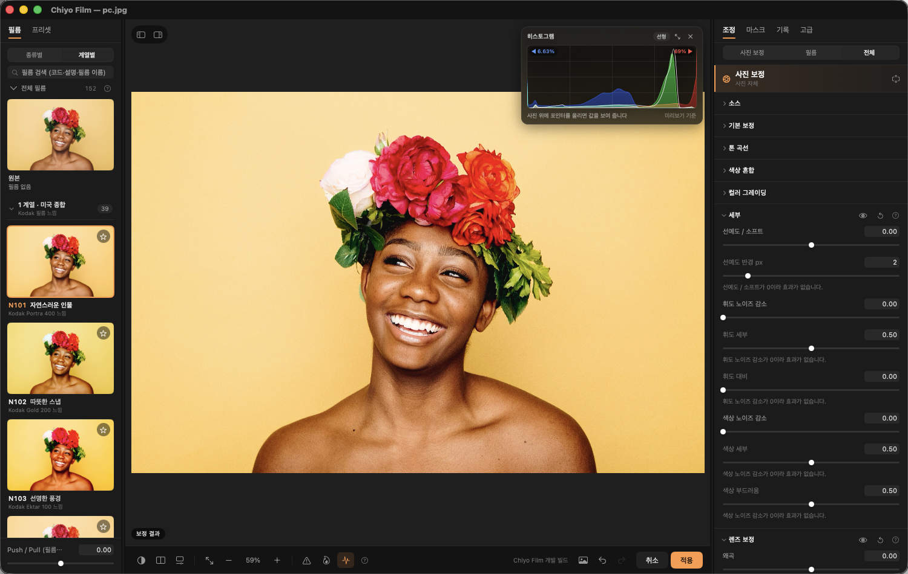
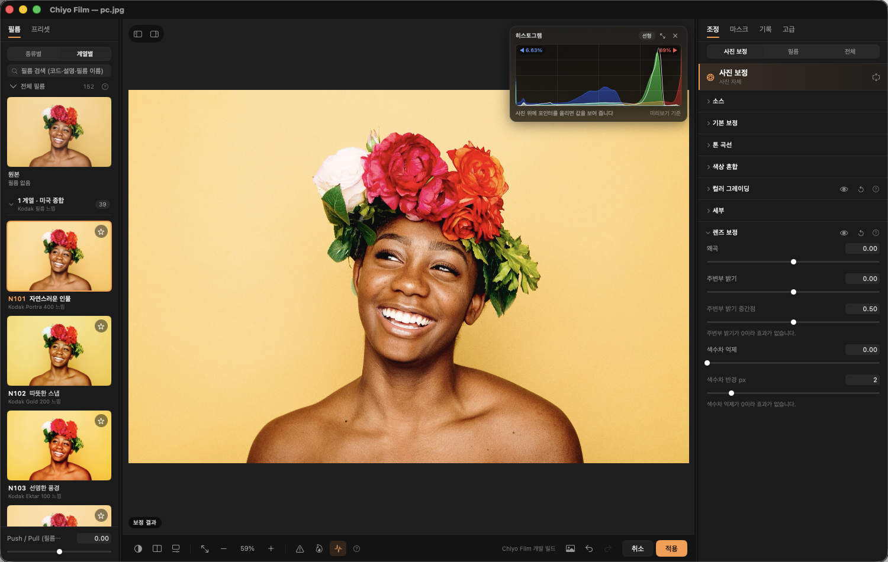

# Chiyo Film

사진에 실제 필름의 색과 입자를 입히는 Mac 편집기. Lightroom Classic과 Photoshop에서 바로 열어 씁니다.



## 다운로드

**[최신 버전 받기 (Releases)](../../releases/latest)** → `ChiyoFilm-1.1.2.pkg`

- macOS 13 이상, Apple Silicon (M1 이상)
- Lightroom Classic, Photoshop 2025 이상 (둘 중 쓰는 것만 있으면 됩니다. 편집기만 단독으로도 쓸 수 있어요)
- 사용 설명서: **[ChiyoFilm-Manual.pdf](ChiyoFilm-Manual.pdf)**
- 이용약관: **[LICENSE](LICENSE)** — 무료 테스트판(개인적·비상업적 사용), 재배포 금지, 결과 사진은 자유롭게 사용. 설치할 때 동의 화면이 나옵니다.

## 설치

1. Photoshop과 Lightroom Classic을 종료합니다 (작업 중인 문서는 먼저 저장).
2. `ChiyoFilm-1.1.2.pkg`를 엽니다. “확인되지 않은 개발자” 경고가 나오면 Finder에서 **우클릭 › 열기**, 또는 **시스템 설정 › 개인정보 보호 및 보안 › 그래도 열기**.
3. 편집기 앱, Photoshop 플러그인, Lightroom 플러그인이 한 번에 설치됩니다.
4. **Lightroom에서 한 번만:** 환경 설정 › 외부 편집 › 추가 외부 편집기 › 선택 › `/Applications/Chiyo Film.app`
   - 파일 형식 **TIFF 또는 PSD**, **16비트**, 색상 공간은 평소 쓰는 것과 같게 (ProPhoto RGB 또는 Adobe RGB)
   - 사전 설정 › 새 사전 설정으로 저장 › “Chiyo Film”

## 사용

| 어디서 | 방법 |
|---|---|
| Lightroom Classic | 사진 우클릭 › 편집 › **Chiyo Film** (⌥⌘E) → 보정 후 **적용** (Return) → 원본 옆에 바로 나타남 |
| Lightroom 여러 장 | 파일 › 플러그인 추가 기능 › **Chiyo Film: 선택한 사진에 일괄 적용…** (TIFF / JPEG / PSD, 카탈로그에 자동 추가) |
| Photoshop | 플러그인 › Chiyo Film › **Chiyo Film 편집기 열기** → 적용하면 새 레이어로 들어옴 |
| 단독 | JPEG · TIFF · PSD 파일을 `Chiyo Film.app`에 끌어다 놓기 |
| 편집기에서 여러 장 | 파일 › **여러 사진에 적용…** (⇧⌘B) |

> **팁:** RAW는 Lightroom에서 노출·화이트밸런스 등 1차 보정을 끝낸 뒤 Chiyo Film에서 필름 룩을 입히세요. 이미 현상된 사진에서 색이 가장 잘 나옵니다.

## 주요 기능 (1.1)

- **필름 152종**: 자체 코드 이름(예: N101 자연스러운 인물, M301 클래식 흑백, C601 차가운 야경)과 어떤 필름을 참고했는지 알려 주는 “~ 느낌” 표기. 종류별·계열별 보기와 검색, 필름마다 그레인·할레이션·블룸 기본값
- **사진 보정 (Lightroom처럼)**: 기본 보정(밝은/어두운 영역, 텍스처, 부분 대비, 디헤이즈, 생동감), 톤 곡선, 색상 혼합, 컬러 그레이딩 휠, 노이즈 감소, 렌즈 보정
- **필름 효과**: 인화 매체(현상소 스캔, 인화지, 영화 인화), 광선(블룸·할레이션·확산·모션·스트릭), 그레인, 빛 샘, 먼지·스크래치, 오버스캔
- **마스크**: 원형·선형·브러시·밝기·색상 범위, 자동 피사체·사람·하늘. 마스크마다 밝은/어두운 영역·텍스처·부분 대비·디헤이즈·생동감·노이즈 감소·색상 보정
- **자르기·회전·수평 맞추기**: 비율 프리셋, 수평선 긋기, 90° 회전·뒤집기 (R 키)
- **액자·배경**: 흰 여백, 즉석 사진 테두리, 흐린 배경 스토리(9:16) 등 12가지 액자와 단색·흐림·종이·캔버스 배경
- **여러 사진에 한 번에 적용**: 편집기에서 사진·폴더를 골라 TIFF·JPEG·PSD로 저장 (⇧⌘B)
- **참조 사진으로 룩 맞추기**, 기본 룩 28종, 내 프리셋, `.cube` LUT 내보내기
- GPU 실시간 미리보기, 히스토그램·웨이브폼·RGB 퍼레이드



## 변경 내역

각 버전의 변경 내용은 [Releases](../../releases)에 있습니다.

## 문제 보고

편집기 **고급 탭 › 문제 보고 파일 만들기**로 만든 파일과 함께 [Issues](../../issues)에 남겨 주세요. macOS·Photoshop·Lightroom 버전과 사진 형식(TIFF/PSD/JPEG, 비트, 색 공간)을 적어 주시면 빨리 해결할 수 있어요. 개인 사진은 올리지 마세요.

## 제거

```sh
sudo "/Library/Application Support/Chiyo Film/1.1.2/uninstall.sh"
```

프리셋·즐겨찾기(`~/Library/Application Support/Chiyo Film`)는 남습니다.

---

무료 테스트판이며 어떠한 보증도 하지 않습니다(자세한 내용은 [이용약관](LICENSE)). 원본 사진은 따로 보관한 상태에서 사용하세요. 필름 룩은 공개된 특성 곡선·데이터시트·스캔 자료를 참고한 표현용 모델이며, 실제 필름과의 일치를 보증하지 않습니다. 필름·제조사 이름은 각 소유자의 상표이며 이 프로그램과 관련이 없습니다. 설명서 화면의 예시 사진은 CC0(퍼블릭 도메인) 사진입니다.
