# Chiyo Film

**[English](README.en.md)** · 한국어

**무료 · 사진 정리부터 RAW 현상·필름 룩·내보내기까지 한 앱에서 · Lightroom Classic / Photoshop에서도 · 필름 룩 154종**

사진에 실제 필름의 색과 입자를 입히는 Mac 편집기. 1.7부터는 폴더를 열어 고르고(셀렉), RAW를 현상하고, 필름처럼 다듬어 내보내는 **사진 라이브러리**로도 혼자 쓸 수 있어요.

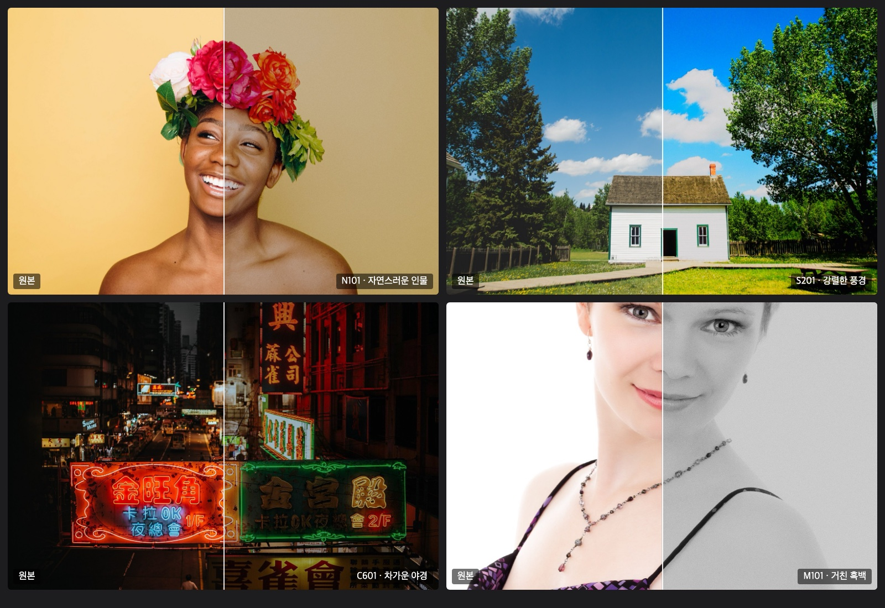

<sub>각 사진의 왼쪽은 원본, 오른쪽은 Chiyo Film(필름 + 노출·색온도·그레인·할레이션 조정). 예시 사진은 Wikimedia Commons의 CC0(퍼블릭 도메인) 사진입니다.</sub>

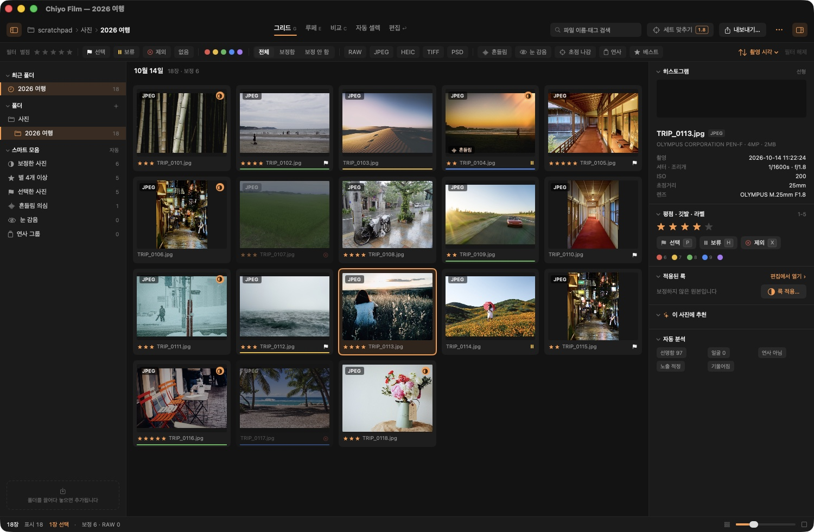

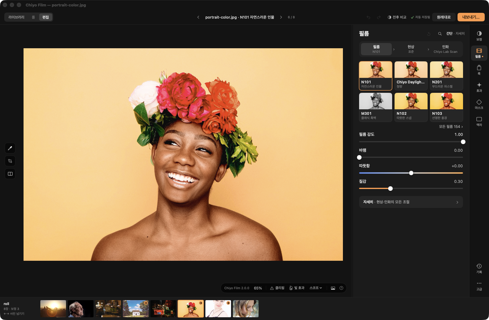

## 다운로드

**[최신 버전 받기 (Releases)](../../releases/latest)** → `ChiyoFilm-1.8.1.pkg`

- macOS 13 이상, Apple Silicon (M1 이상)
- Lightroom Classic, Photoshop 2025 이상은 선택 (없어도 라이브러리·편집기로 단독 사용)
- RAW: macOS가 지원하는 카메라, 그리고 Sony A7 V · A7R VI의 Compressed RAW 2(앱에 포함된 LibRaw로 현상, Adobe DNG Converter 필요 없음)
- 사용 설명서: **[ChiyoFilm-Manual.pdf](ChiyoFilm-Manual.pdf)**
- 이용약관: **[LICENSE](LICENSE)** — 무료 테스트판(개인적·비상업적 사용), 재배포 금지, 결과 사진은 자유롭게 사용. 설치할 때 동의 화면이 나옵니다.

## 설치

1. Photoshop과 Lightroom Classic을 종료합니다 (작업 중인 문서는 먼저 저장).
2. `ChiyoFilm-1.8.1.pkg`를 엽니다. “확인되지 않은 개발자” 경고가 나오면 Finder에서 **우클릭 › 열기**, 또는 **시스템 설정 › 개인정보 보호 및 보안 › 그래도 열기**.
3. 편집기 앱(`/Applications/Chiyo Film.app`), Photoshop 플러그인, Lightroom 플러그인이 한 번에 설치됩니다. 이전 버전 위에 그대로 설치하면 되고, 프리셋·즐겨찾기·편집 기록은 유지됩니다.

### Lightroom Classic 설정 (처음 한 번)

Lightroom에서 **사진 › 편집 › Chiyo Film**으로 보내려면 Chiyo Film을 ‘추가 외부 편집기’로 등록하고 사전 설정으로 저장합니다.

1. Lightroom Classic 메뉴 막대의 **Lightroom Classic › 설정…**(⌘,)을 엽니다. 버전에 따라 ‘환경 설정’이라고 나옵니다.
2. 창 위쪽 탭에서 **외부 편집**을 누릅니다. **‘사전 설정’ 탭이 아닙니다** — 두 탭 이름이 비슷해 헷갈리기 쉽습니다.
3. 맨 위 ‘Adobe Photoshop에서 편집’ 영역은 그대로 두고, 아래쪽 **추가 외부 편집기** 영역에서:
   - **응용 프로그램 › 선택…** → `/Applications/Chiyo Film.app`
   - **파일 형식**: TIFF (또는 PSD)
   - **색상 공간**: ProPhoto RGB (또는 평소 쓰는 Adobe RGB)
   - **비트 심도**: 16비트/구성요소
   - **해상도**: 그대로 (300)
4. 같은 영역 **맨 위 줄의 ‘사전 설정:’ 드롭다운**(지금은 ‘사용자 정의’로 보임)을 열고 **현재 설정을 새 사전 설정으로 저장…**을 고른 뒤 이름을 **Chiyo Film**으로 저장합니다. 3번을 먼저 맞춘 뒤 저장해야 그 설정이 담깁니다.
5. 창을 닫습니다. 이제 사진을 오른쪽 클릭 › **편집 › Chiyo Film**(⌥⌘E)이 생깁니다. 처음 보낼 때 묻는 창에서 **“Lightroom 조정으로 사본 편집”**을 고르세요.

> Chiyo Film 앱의 **도움말 › 처음 사용 안내 › Lightroom · Photoshop 연결 확인**에서 등록이 됐는지 확인할 수 있습니다. Lightroom(클라우드 버전)은 외부 편집을 지원하지 않아 **Classic**만 됩니다.

### Photoshop 플러그인

설치하면 **플러그인 › Chiyo Film › Chiyo Film 편집기 열기**가 생깁니다(오른쪽 패널이 아니라 **메뉴 명령**입니다). Photoshop 2025 이상이 필요합니다.

**메뉴에 안 보이면 순서대로:**
1. Photoshop을 완전히 종료(⌘Q)했다가 다시 켭니다. 설치할 때 Photoshop이 켜져 있었다면 꼭 필요합니다.
2. **플러그인 › 플러그인 관리…**(Creative Cloud 앱이 열림) › 설치된 플러그인에서 Chiyo Film이 **켜짐**인지 확인합니다.
3. Chiyo Film 앱의 **도움말 › Photoshop 플러그인 다시 설치…**를 누릅니다. Adobe 플러그인 설치 도구로 다시 설치하고, 그게 안 되면 Creative Cloud에 설치를 맡깁니다(창이 뜨면 ‘설치’). 그다음 Photoshop을 다시 켭니다.
4. 그래도 안 되면 Finder에서 ⇧⌘G로 `/Library/Application Support/Chiyo Film/1.8.1/`를 열고 `chiyo-film-1.8.1-photoshop.ccx`를 **더블클릭**합니다.

> Photoshop 플러그인은 Creative Cloud 앱을 통해 설치됩니다. Creative Cloud 앱이 없거나 로그아웃되어 있으면 설치되지 않으니 먼저 설치·로그인하세요. 처음 실행할 때 Photoshop이 편집기 실행 권한을 물으면 **‘내 선택 기억’**을 켜고 허용합니다.

## 사용

| 어디서 | 방법 |
|---|---|
| Lightroom Classic | 사진 우클릭 › 편집 › **Chiyo Film** (⌥⌘E) → 보정 후 **적용** (Return) → 원본 옆에 바로 나타남 |
| Lightroom 여러 장 | 파일 › 플러그인 추가 기능 › **Chiyo Film: 선택한 사진에 일괄 적용…** (TIFF / JPEG / PSD, 카탈로그에 자동 추가) |
| Photoshop | 플러그인 › Chiyo Film › **Chiyo Film 편집기 열기** → 적용하면 새 레이어로 들어옴 |
| **사진 라이브러리 (새)** | `Chiyo Film.app`을 열고 폴더 열기(⌘O) → 그리드·루페에서 별점·깃발(1–5 · P · X) → Enter로 편집 → ⌘E 내보내기 |
| 단독 | JPEG · TIFF · PSD · RAW 파일을 `Chiyo Film.app`에 끌어다 놓기 |
| 편집기에서 여러 장 | 파일 › **여러 사진에 적용…** (⇧⌘B) |
| 한 화면에 2–4장 | 파일 › **여러 장 배치 만들기…** (⇧⌘L) |

> **팁:** RAW는 라이브러리에서 바로 열어 **RAW 현상**(노출·화이트밸런스·하이라이트 복구)부터 하세요. Lightroom을 쓰신다면 지금처럼 Lightroom에서 현상한 뒤 Chiyo Film으로 보내도 됩니다.

## 주요 기능 (1.8)

- **세트 맞추기 (새)**: 같은 장소·같은 날 찍은 여러 장의 밝기·화이트밸런스·피부색(얼굴마다 따로 재서)·대비·채도를 기준 사진에 맞춰 고르게. 사진마다 바뀔 값과 전·후 미리 보기, 강도 조절, ⌘Z 한 번에 되돌리기
- **RAW: 모든 카메라 브랜드 (새)**: 프로파일 ‘카메라 JPEG처럼’ — RAW 안의 카메라 JPEG로 기종마다 한 번 배워 그 카메라의 밝기·색(피부색 포함)에 맞춤(Canon·Nikon·Fujifilm·Panasonic·OM System·Pentax·Sony 샘플에서 밝기 ±0.07 EV, 피부 색조 0~4° 차이). 색수차 자동 보정(렌즈 정보 없이 사진에서 직접 재서), Fujifilm X-Trans도 내장 변환으로
- **사진 라이브러리 (새)**: 폴더를 열면 그리드 · 루페 · 비교 · 자동 셀렉. 별점·깃발·색상 라벨을 키보드로(1–5 · P · H · X · 6–9), 필터와 스마트 모음(보정한 사진, 별 4개 이상, 흔들림·눈 감음 의심, 연사). 보정은 사진 옆 `.chiyo` 파일에 자동 저장(카탈로그 없음), RAW의 별점·라벨은 `.xmp`로도 써서 Lightroom·Bridge와 주고받음
- **자동 셀렉 도움 (새)**: 연사 묶기와 베스트 컷 제안, 흔들림·초점 나감·눈 감음·노출 표시
- **RAW 현상 (새)**: macOS RAW 엔진으로 노출·화이트밸런스·하이라이트 복구·그림자, 화이트 위 빛까지 살리는 관용도. Sony A7 V · A7R VI도 바로 열림. RAW+JPG를 두 장 또는 한 장으로
- **여러 장 한꺼번에 (새)**: ⌘·⇧ 클릭 복수 선택, 보정 **동기화**(항목 고르기)와 **자동 동기화**, 보정 복사·붙여넣기, 이전 사진 보정 적용, **가상 사본**(⌘'), 오른쪽 클릭 메뉴
- **내보내기 (새)**: 웹·SNS · 인쇄 TIFF · 인스타그램 4:5 · 원본 크기 · Photoshop용 PSD 프리셋, JPEG·HEIC·TIFF·PSD, 예상 용량, 이름 템플릿, 백그라운드 대기열. 편집 화면과 루페에서 바로(⌘E), 깃발 고른 사진만 한 번에
- **Lightroom처럼 바뀐 기본 보정**: 밝은 영역·흰색 계열이 하이라이트를 자연스럽게 되살리고, 슬라이더가 바로 반응. 피부톤 자동 맞춤은 얼굴에만
- **스펙트럼 색 계산**: 필름 층의 분광 감도와 인화 염료까지 계산해 빨강·피부가 덜 탁하고 맑게. 새 편집부터 기본이고 예전 편집은 그대로(조정 › 필름 맨 위 ‘색 계산’)
- **영어 화면**: 맥 언어를 따라가고 고급 탭에서 바꿀 수 있음
- **이 사진에 추천**: 사진을 열면 색 조화와 장면·분위기를 보고 어울리는 룩 3–5개를 이유와 함께 추천
- **영화 룩 30종**: 일본·한국·세계 영화 한 장면의 분위기(고레에다 히로카즈, 이와이 슌지, 왕가위, 박찬욱, 봉준호, 드니 빌뇌브 등 “~ 느낌”). 영화마다 촬영 정보를 찾고 실제 장면의 색을 재서 맞춤
- **영화 액자 (새)**: 시네마스코프 2.39 · 비스타 1.85 레터박스, 자막 장면
- **현상·인화**: 현상 푸시/풀, 프린터 포인트 R·G·B, 프리플래시, 인화 곡선 모양, 블리치 바이패스(창작 모델)
- **질감·광학**: 필름 포맷(하프~4×5)에 맞춘 그레인·할레이션, 데이터시트 입상도 기반 그레인, 확산 필터(블랙·화이트 미스트, 반짝임, 시네 블룸 — 마스크로 부분 적용), 색수차·코마
- **필름 154종**: 그중 59종은 제조사 데이터시트의 특성 곡선으로 렌더. 자체 코드 이름(예: N101 자연스러운 인물, M301 클래식 흑백, C601 차가운 야경)과 어떤 필름을 참고했는지 알려 주는 “~ 느낌” 표기. 종류별·계열별 보기와 검색, 필름마다 그레인·할레이션·블룸 기본값
- **얼굴 피부 보정 (새)**: 얼굴과 눈·눈썹·입술을 자동으로 찾아 잡티(점·좁쌀·뾰루지·갈색 자국)·다크서클을 지우고 피부를 고르게. 모공·윤기·빛과 그림자는 그대로
- **피부톤 (새)**: 피부색을 기준 색으로 고르게(균일하게) + 색온도·틴트·채도·밝기, 색상 휠로 범위 조절
- **정밀 색보정 (새)**: 리프트·감마·게인·오프셋 휠, 색조·밝기·채도 곡선 5종. 톤 곡선 ‘밝기’ 채널, 빠른 조정 키(Q·W·E…), 자동 수평(⇧A)
- **사진 보정 (Lightroom처럼)**: 기본 보정(밝은/어두운 영역, 텍스처, 부분 대비, 디헤이즈, 생동감), 톤 곡선, 색상 혼합, 컬러 그레이딩 휠, 노이즈 감소, 렌즈 보정
- **필름 효과**: 인화 매체(현상소 스캔, 인화지, 영화 인화), 광선(블룸·할레이션·확산·모션·스트릭), 그레인, 빛 샘(1.8.1: 사진 위 핸들로 위치·방향 조절), 먼지·잔섬유(1.8.1: 더 자연스럽게)·스크래치, 오버스캔
- **마스크**: 원형·선형·브러시·밝기·색상 범위, 자동 피사체·사람·하늘. 마스크마다 밝은/어두운 영역·텍스처·부분 대비·디헤이즈·생동감·노이즈 감소·색상 보정
- **자르기·회전·수평 맞추기**: 비율 프리셋, 수평선 긋기, 90° 회전·뒤집기 (R 키)
- **액자·배경**: 기본 액자 26가지. 사진에서 고른 색 팔레트·오로라·듀오톤 배경, 여백 글자(날짜·필름 코드, 글꼴 4가지), 35mm 필름 스트립·밀착 인화·찢은 종이 가장자리·테이프·집게, 나무결·대리석·콘크리트 등 질감
- **여러 장 배치**: 사진 2–4장을 한 화면에(9가지 배치), 인스타그램 넘겨보기용 띠는 칸별 파일로도 저장 (⇧⌘L)
- **날짜 각인**: 날짜를 한 칸에 입력(19981113, 98 11 13 …), 달력·촬영일·오늘 단추
- **여러 사진에 한 번에 적용**: 편집기에서 사진·폴더를 골라 TIFF·JPEG·PSD로 저장 (⇧⌘B)
- **참조 사진으로 룩 맞추기**, 기본 룩 28종, 내 프리셋, `.cube` LUT 내보내기(33·65, sRGB·P3·Rec.709)
- GPU 실시간 미리보기, 히스토그램·웨이브폼·RGB 퍼레이드

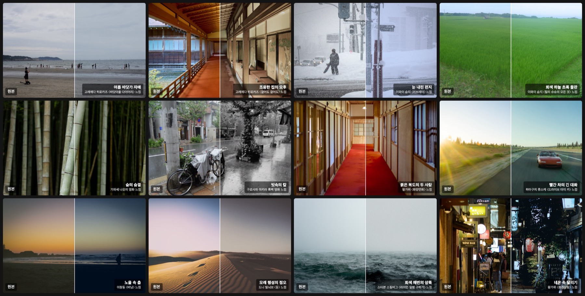

<sub>영화 룩 예시 — 왼쪽 원본 · 오른쪽 룩. 예시 사진은 Wikimedia Commons의 CC0 사진이며 영화 장면이 아닙니다. 룩은 공개된 촬영 정보를 바탕으로 한 해석이고 감독·영화사와 관계가 없습니다.</sub>

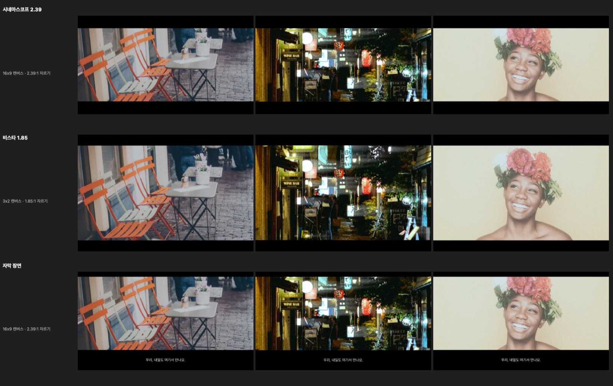

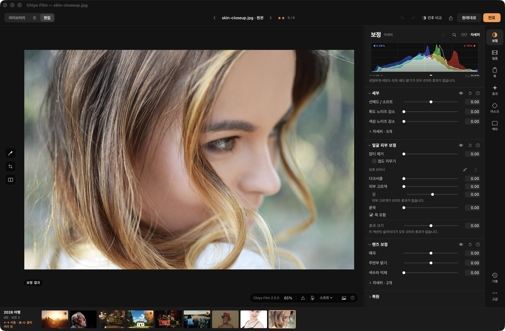

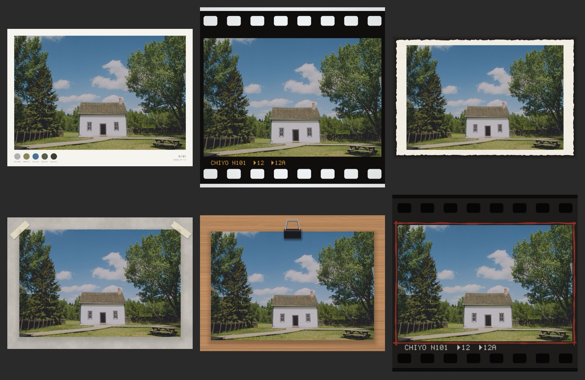

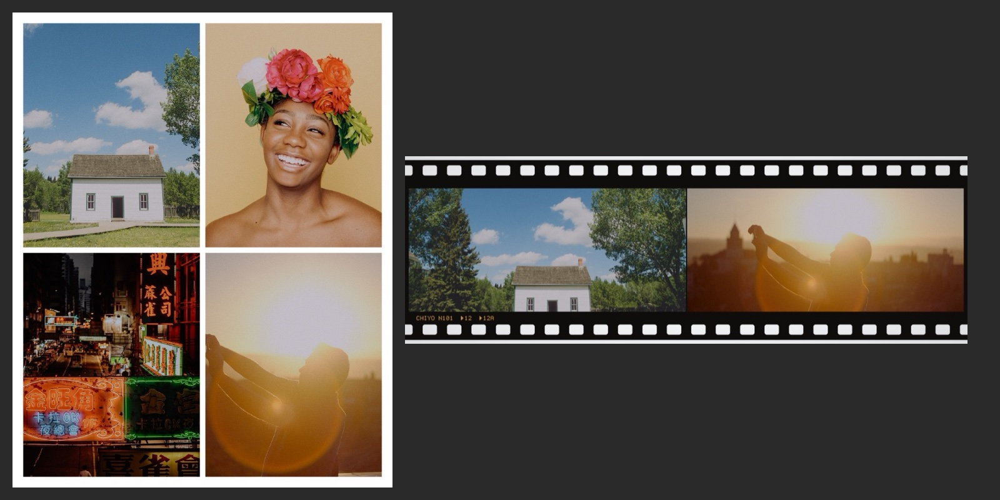

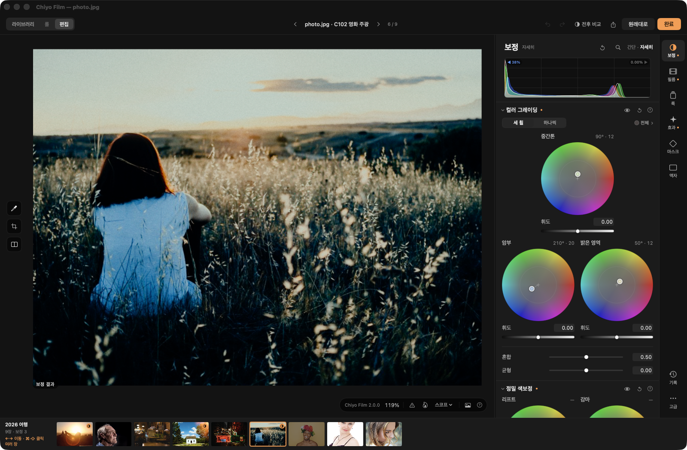

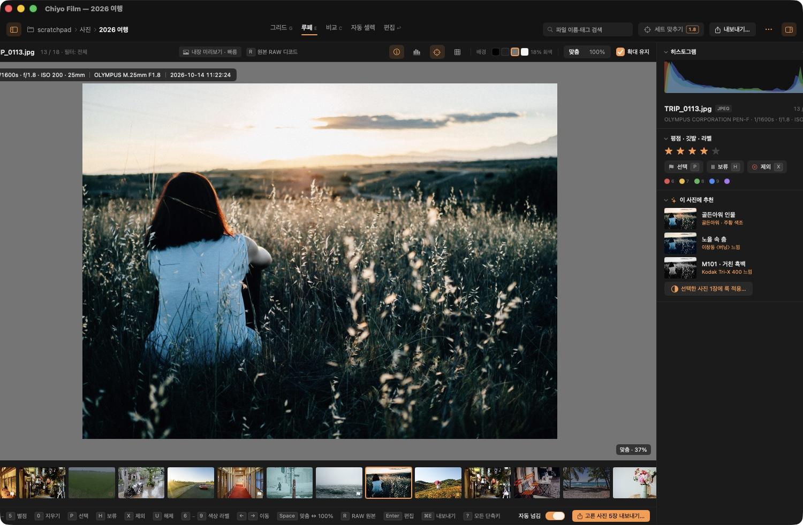

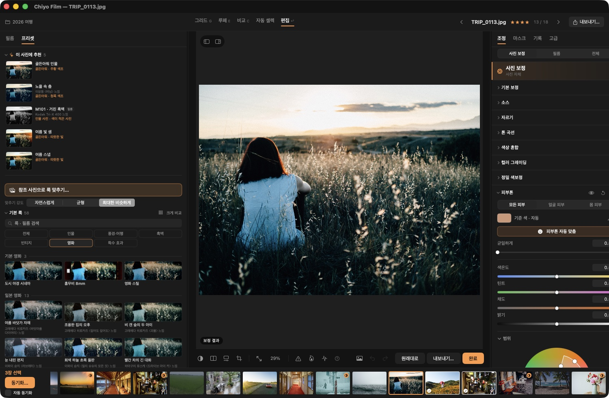

## 변경 내역

각 버전의 변경 내용은 [Releases](../../releases)에 있습니다.

## 문제 보고

편집기 **고급 탭 › 문제 보고 파일 만들기**로 만든 파일과 함께 [Issues](../../issues)에 남겨 주세요. macOS·Photoshop·Lightroom 버전과 사진 형식(TIFF/PSD/JPEG, 비트, 색 공간)을 적어 주시면 빨리 해결할 수 있어요. 개인 사진은 올리지 마세요.

## 제거

```sh
sudo "/Library/Application Support/Chiyo Film/1.8.1/uninstall.sh"
```

프리셋·즐겨찾기(`~/Library/Application Support/Chiyo Film`)는 남습니다.

---

무료 테스트판이며 어떠한 보증도 하지 않습니다(자세한 내용은 [이용약관](LICENSE)). 원본 사진은 따로 보관한 상태에서 사용하세요. 필름 룩은 공개된 특성 곡선·데이터시트·스캔 자료를 참고한 표현용 모델이며, 실제 필름과의 일치를 보증하지 않습니다. 필름·제조사 이름은 각 소유자의 상표이며 이 프로그램과 관련이 없습니다. 설명서 화면의 예시 사진은 CC0(퍼블릭 도메인) 사진입니다.
